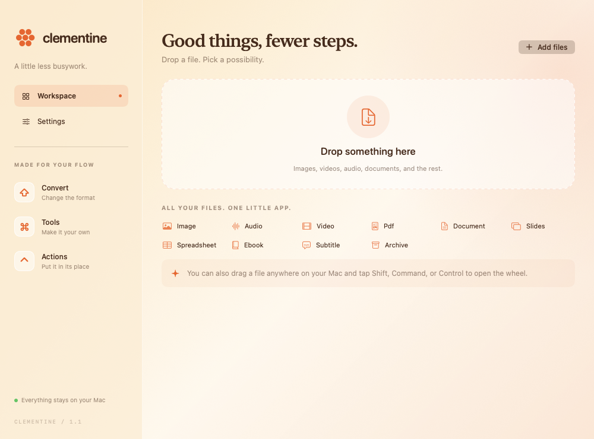

# Clementine

A native Swift menu-bar utility for offline file conversions, editing tools, and floating files. Built for this Apple silicon Mac. No accounts, subscriptions, conversion limits, or uploads.

[Website](https://corypearl.github.io/clementine/) · [Download v1.2 preview](https://github.com/CoryPearl/clementine/releases/tag/v1.2.0-preview) · [Launch film](brag-output/brag.mp4)

The current preview requires **Apple silicon and macOS 26+**. Download the ZIP, extract it, and move Clementine to Applications. This is an ad-hoc signed preview, **not Apple-notarized**; macOS may block its first launch. After attempting to open it, review the app's source and use System Settings → Privacy & Security → Open Anyway if you choose to run it. Its orange icon appears in the menu bar. The release includes a SHA-256 checksum.



## Run

Open **dist/Clementine.app**. The orange cluster icon in the menu bar opens the workspace. Drop files into the workspace, or drag a file in Finder and tap:

- **Shift** — conversion formats
- **Command** — editing tools
- **Control** — file actions

Release the modifier and drop onto a wheel segment to apply it. Escape cancels. Scroll switches wheel pages. Shortcuts can be changed in Settings. Enable Accessibility in Settings for global keyboard control if needed. Tangerine should be quit while testing Clementine because both use the same default shortcuts.

Conversions and edits save new files beside the originals unless a different output folder is selected. Existing files are never overwritten. Copy, Move, AirDrop, Copy Path, Terminal, and Float operate on the selected original files. Double-click files in a Float for Quick Look; drag them into other apps or drop additional files into the Float.

Pages, Numbers, and Keynote are used for their native formats. Allow the macOS Automation prompt when first using those conversions. They can briefly open a document window. All other conversion engines are bundled.

## Appearance and motion

Version 1.1 uses orange-tinted native Liquid Glass on macOS 26, rounded radial segments, a spring opening, a short fade-and-shrink close, and animated hover/mode changes. Reduce Motion removes these animations; Reduce Transparency provides opaque, readable surfaces. Static previews approximate the glass tint because backdrop effects require the live window compositor.

## Live editing

Version 1.2 replaces the editor's manual Preview step with an automatically updating canvas. Drag any crop border or one of eight handles, or drag inside the selection to move it. Pixel fields and the crop stay synchronized; arrow keys move by one pixel, Shift by ten.

Photo adjustments, flips, rotation, annotations, blur/solid redaction and backgrounds update while editing. The canvas uses the same native image renderer as the full-resolution save. Compression refreshes the actual encoded image or PDF automatically after a short pause in input. Media playback applies trim boundaries, speed, video redaction, gain, channel mixing and audio bleeps without exporting an eight-second excerpt. File encoding still happens when saving.

**Remove Background** is available from the image tools wheel, and as a toggle in Edit Photo and Add Background. It uses Apple's on-device subject segmentation. Removed backgrounds display as a checkerboard; transparent cutouts save as full-resolution PNG files. The first subject detection takes a moment; the result is cached while you continue editing. Photos with no recognizable foreground show a clear error instead of silently saving the original.

## Features

The registry includes the reference's 275 conversion routes, 27 file tools, and six actions, plus HTML, Keynote, and Numbers inputs. See [coverage](docs/COVERAGE.md) for verification results and practical differences.

Image tools include conversion, compression, cropping, color adjustments, annotation, backgrounds, local face/text detection, flattened redaction, metadata editing, QR/barcode reading, collages, and PDF creation. Media tools include playback, trimming, splitting, cropping, speed, normalization, channel conversion, muting, joining, snapshots, visualizers, and time-based redaction. PDF tools provide page images, editable document exports, OCR, splitting, merging, and page ordering/rotation. Archives support ZIP/TAR/GZIP conversion and RAR extraction.

PDF-to-Office reconstruction is best effort. It extracts editable text and uses local OCR for scanned pages; complex typography, illustrations, equations, and tables may not reconstruct accurately. Compressed PDFs are rasterized and lose text selection/search. The editor states this before export. Video redaction uses solid rectangles. Archive extraction rejects links and special files.

## Build

Requirements: Xcode/Swift 6, Python 3, Homebrew, Apple silicon. This packaged build uses macOS 26 engines.

```sh
brew install ffmpeg imagemagick exiftool pandoc librsvg
brew fetch --cask libreoffice
python3 scripts/package.py
```

The packager verifies the LibreOffice download, bundles engine libraries and modules, rewrites their library paths, includes dependency recipes/notices, signs nested code and the app locally, verifies signatures, and creates `dist/Clementine.zip`. Use `--reuse-tools` after Swift-only changes. Use `--no-zip` to skip archive creation. The app requires neither Homebrew nor a command-line PATH at runtime. No Apple Developer account is required for this personal ad-hoc build.

```sh
CLEMENTINE_TOOLS="$PWD/dist/Clementine.app/Contents/Resources/Tools" CLEMENTINE_DISABLE_APPLE_AUTOMATION=1 swift test
```

For the complete conversion-route integration check, add `CLEMENTINE_FULL_MATRIX=1`. Pages routes are recorded as manual checks; automated tests do not launch Pages, Numbers, or Keynote.

The app executable also supports command-line conversion:

```sh
dist/Clementine.app/Contents/MacOS/Clementine --convert png photo.heic --output /path/to/folder
dist/Clementine.app/Contents/MacOS/Clementine --tool createPDF photo1.jpg photo2.png
```

All subprocess calls pass arguments directly; bundled converters run with outbound IP connections denied. Macro execution and link updates are disabled in the private LibreOffice profile. Temporary outputs are cleaned up on success, failure, or cancellation. Jobs are limited to two concurrent workers.

## Project layout

`Sources/Clementine` contains the native interface, capability registry, drag integration, editors, and conversion engines. `scripts/package.py` builds the self-contained app; `Tests/ClementineTests` exercises conversions, output integrity, cancellation, PDF operations, redaction, and archive handling. `Resources` contains original artwork or previews. Third-party tools are obtained independently; no Tangerine code or bundled assets are incorporated.

Original Clementine source and artwork are MIT licensed. Third-party binaries keep their own licenses; the MIT license does not relicense those tools. [Third-party notices and exact source directions](ThirdParty/README.md) accompany the release. The bundled `Contents/Resources/Licenses` contains notices and exact Homebrew recipes, and LibreOffice retains its own license files inside its nested app.

## Website and video

`website/` is a buildless single-screen download page, deployed by `.github/workflows/pages.yml`. `brag-output/` contains the editable Hyperframes composition, storyboard, original soundtrack, 20-second film, poster, and share copy. See [website development](website/README.md).
